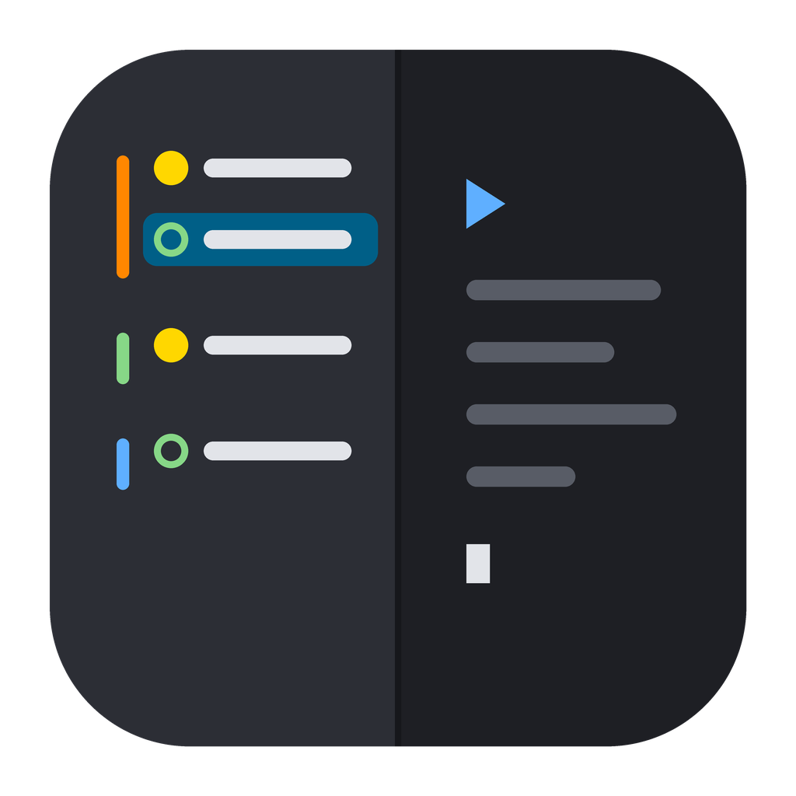
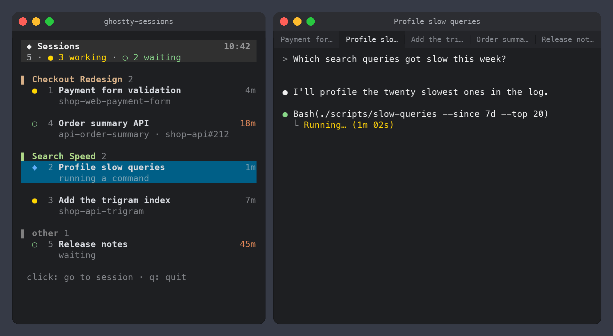
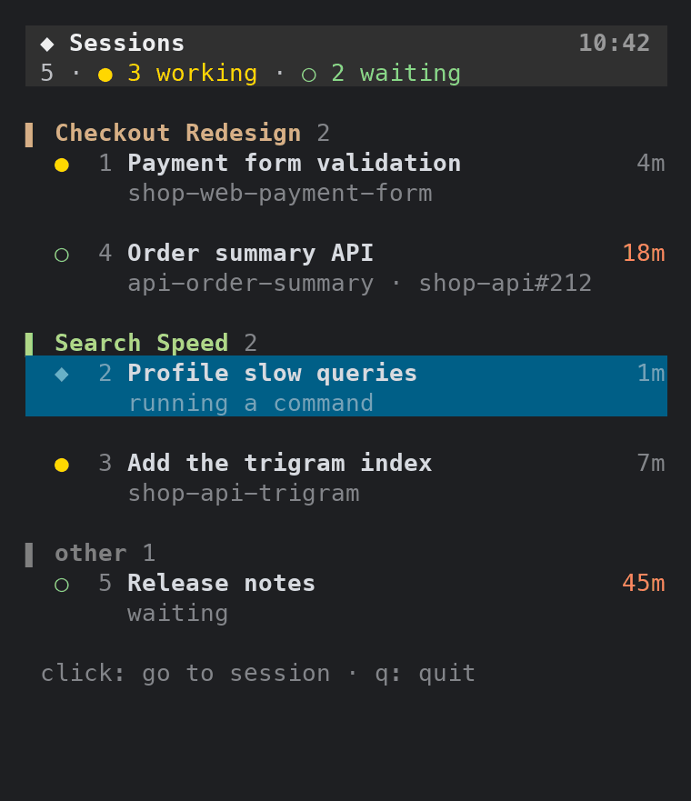

# ghostty-sessions

A sidebar for [Ghostty](https://ghostty.org) that lists every
[Claude Code](https://claude.com/claude-code) session you have open, grouped by
what each one is working on. Click a session to jump to its tab.



<sub>Made-up sessions. The sidebar is drawn by the real code: <code>docs/demo_window.py</code>.</sub>

With ten sessions in ten tabs, the tab bar tells you nothing. This tells you which
sessions are working, which are waiting for you and for how long (orange after 15
minutes), which worktree and pull request each one is on, and which ones belong to
the same piece of work.

macOS and Ghostty only. One Python file, no dependencies.

## Get started

**1. Install.** In Claude Code, run:

```
/plugin install ghostty-sessions --marketplace gorkamb/ghostty-claude-sessions
```

Answer `y` to add the marketplace, and pick "user" to have it in every project.
Then `/reload-plugins`.

**2. Set it up.** Run:

```
/ghostty-sessions:setup
```

Claude checks that everything is in place, looks for where you keep plan files,
writes the config and opens the sidebar. From then on the sidebar opens by itself
when a session starts in Ghostty, if it is not open already.

The first time, macOS asks whether your terminal may control Ghostty. Say yes:
that is how it reads the tabs and switches between them.

| Command | What it does |
| --- | --- |
| `/ghostty-sessions:setup` | checks, finds your plans, writes the config, opens the sidebar |
| `/ghostty-sessions:open` | opens the sidebar, if it is not open |
| `/ghostty-sessions:plan NAME` | pins this session to a plan (see Grouping); `-` unpins |

<details>
<summary>Without the plugin</summary>

```sh
git clone https://github.com/gorkamb/ghostty-claude-sessions.git
ln -s "$PWD/ghostty-claude-sessions/ghostty-sessions" /usr/local/bin/ghostty-sessions
ghostty-sessions --check      # what is missing, if anything
ghostty-sessions --sidebar
```

Any folder on your `PATH` works instead of `/usr/local/bin`. Write the config by
hand (see Configuration).

</details>

## Use

From a shell, with or without the plugin:

| Command | What it does |
| --- | --- |
| `ghostty-sessions --sidebar` | opens the list in a narrow Ghostty window on the left |
| `ghostty-sessions` | prints the list once |
| `ghostty-sessions --watch 3` | the interactive list in the current terminal, refreshed every 3 s |
| `ghostty-sessions --plan NAME` | from inside a session: pins it to a plan (see below); `-` unpins |
| `ghostty-sessions --check` | says whether everything it needs is in place |

In the list: click a session to go to its tab, `q` to quit.

| Mark | Meaning |
| --- | --- |
| `●` | working |
| `◆` | running a shell command |
| `○` | waiting for you; the time turns orange after 15 minutes |
| `·` | a tab with no Claude Code session |

## Grouping

**By repository**, out of the box: each session goes under the git repository it
was started in, and a worktree goes with its repository.

**By plan**, if you keep plans or specs as files. Tell it where they are:

```json
{
  "plans": [{"dir": "~/work/notes", "pattern": "PLAN_*.md"}]
}
```

Each session then goes under the plan it is working on, judged from what it does
with its tools: among its last 60 mentions of a plan file, the one with the most
weight. Editing a plan weighs 10, reading or naming it weighs 1. A session that
moves on to another plan moves group.



When that guess is wrong, for example a session that edited someone else's plan in
passing, the session can say so itself: `/ghostty-sessions:plan checkout` (any part
of the file name that matches only one plan works).

## Configuration

All optional, in `~/.config/ghostty-sessions/config.json` (or the file named by
`GHOSTTY_SESSIONS_CONFIG`):

| Key | Default | |
| --- | --- | --- |
| `plans` | `[]` | folders of plan files and their pattern, with one `*` |
| `edit_weight` | `10` | how much editing a plan weighs against reading it |
| `window` | `60` | how many recent plan mentions count |
| `strip_prefixes` | `[]` | prefixes removed from worktree and repository names, e.g. `["acme-"]` |
| `claude_dirs` | every `~/.claude*` with sessions | Claude Code config folders to read |
| `auto_open` | `false` | open the sidebar when a session starts in Ghostty (the setup turns it on) |
| `ghostty_app` | `/Applications/Ghostty.app` | |
| `sidebar` | `{"width": 44, "font_size": 11}` | width in columns |

## What it reads

Everything stays on your machine. It sends nothing anywhere.

- Ghostty's windows and tabs, through Ghostty's AppleScript support (JXA).
- `~/.claude/sessions/<pid>.json`, where Claude Code keeps each running session's
  status.
- The saved conversations in `~/.claude/projects/`, and only the tool calls in
  them (which files a session read or edited, which commands it ran), to find
  its plan, worktree and pull request. It never shows their content.

The only thing it changes is which tab has focus, when you click. The plugin adds a
hook that runs `--auto-open` when a session starts: it opens the sidebar only if
`auto_open` is on, the session runs in Ghostty and no sidebar is open, and it never
blocks or fails the session.

## Limits

- Ghostty on macOS only: it needs Ghostty's AppleScript support. Tested with
  Ghostty 1.4.0 and Claude Code 2.1.319.
- `sessions/<pid>.json` is an internal Claude Code file, not a documented API. A
  Claude Code update can change it and break the status column.
- The sidebar opens on the main display, at the left edge. Ghostty does not take a
  negative position, and moving it afterwards would need the Accessibility
  permission, which this tool does not ask for.
- The first click on the sidebar after using another window only activates it,
  unless the pointer moved over it first.
- A worktree or pull request is the last one the session touched or opened, which
  is usually, but not always, the one it is working on.

## Development

```sh
python3 -m unittest discover -s tests -v
```

The tests need neither Ghostty nor a running session.

This is a personal tool shared as is. Issues and pull requests are welcome, but
there is no promise of support.

## License

[MIT](LICENSE)
